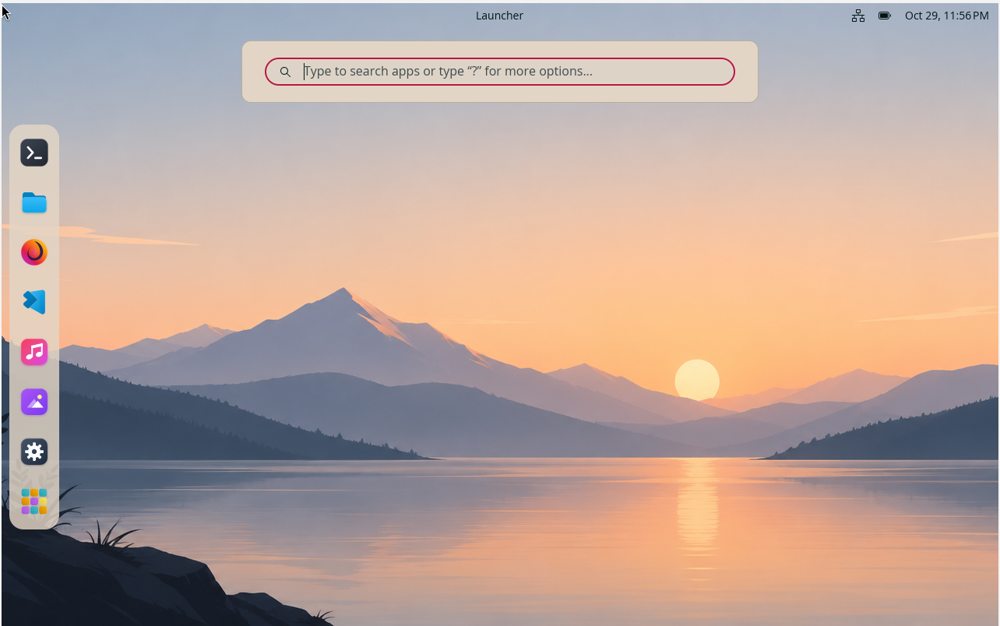

# NivOS: Bespoke Modern Linux Operating System



[](https://kernel.org)
[-red?style=flat-square&logo=debian)](https://debian.org)
[-orange?style=flat-square)](https://system76.com/cosmic)
[](https://wayland.freedesktop.org/)
[]()
[]()

**NivOS** is a custom, lightweight, high-performance x86_64 Linux operating system engineered from the ground up. It pairs a custom-compiled Linux 7.3 kernel with a Debian Sid rolling rootfs, a memory-compressed ZRAM backend, and System76's next-generation Rust-based **COSMIC Wayland desktop environment**.

The project features a completely automated, idempotent 4-stage build pipeline that packages the OS into both a **bootable dual UEFI/BIOS Live ISO** and a **hardware-accelerated WSL2 distribution**.

---

## Key Highlights

- **Custom Linux 7.3 Kernel**: Built from upstream source with low-latency dynamic preemption (`CONFIG_PREEMPT_DYNAMIC`), in-kernel ZRAM swapping (`ZSTD`), SquashFS + OverlayFS live boot layering, and EFI stub loader.
- **Universal Hypervisor & Bare-Metal Graphics**: Broad DRM/KMS acceleration drivers configured directly in the kernel: VirtIO-GPU, VMware (`vmwgfx`), VirtualBox (`vboxvideo`), Bochs, SimpleDRM fallback framebuffers, AMDGPU, Intel i915, and Nouveau.
- **Rust-Based COSMIC Desktop**: Native Wayland compositor (`cosmic-comp`) and modular desktop components written in Rust, tailored with custom dock geometries, floating panels, minimalist vector icons, and a dark pastel colorway.
- **Dual Bootable Targets**:
  - **Hybrid Live ISO (`NivOS-7.3-x86_64.iso`)**: Bootable on bare-metal or virtual machines under both modern UEFI (with Secure Boot disabled) and legacy BIOS via GRUB2 el-torito emulation.
  - **WSL2 Importable Appliance (`nivos-rootfs.tar.gz`)**: Full rootfs tarball ready for instant zero-overhead import into Windows WSL2 with WSLg Wayland display and PulseAudio forwarding.
- **Deterministic & Idempotent Toolchain**: Modular multi-stage pipeline utilizing traps, bind-mount cleanups, and chroot isolation to ensure reproducible artifact generation.

---

## System Architecture & Build Pipeline

```mermaid
flowchart TD
    A[build.sh --all] --> B[Stage 1: Kernel Pipeline]
    A --> C[Stage 2: RootFS Assembly]
    A --> D[Stage 3: Live ISO Packaging]
    A --> E[Stage 4: WSL2 Packaging]

    subgraph "Stage 1: Kernel"
        B --> B1[Fetch Linux 7.3 Source]
        B1 --> B2[Apply Low-Latency & DRM Configs]
        B2 --> B3[Compile Kernel .deb Packages]
    end

    subgraph "Stage 2: RootFS"
        C --> C1[Debootstrap Debian Sid amd64]
        C1 --> C2[Install Custom Kernel 7.3]
        C2 --> C3[Install COSMIC Desktop & Wayland]
        C3 --> C4[Apply Custom Dock, Icons & SDDM]
    end

    subgraph "Stage 3: Hybrid ISO"
        D --> D1[Compress RootFS to SquashFS (ZSTD)]
        D1 --> D2[Extract vmlinuz & initrd]
        D2 --> D3[grub-mkrescue UEFI + BIOS Live Image]
    end

    subgraph "Stage 4: WSL2"
        E --> E1[Archive Minimal Rootfs]
        E1 --> E2[nivos-rootfs.tar.gz for wsl --import]
    end
```

---

## Repository Structure

```
.
├── build.sh                              # Master build entrypoint (options: --all, --kernel, --rootfs, --iso, --wsl)
├── AGENTS.md                             # Architectural principles & verification contracts
├── Screenshot.png                        # NivOS desktop runtime capture
├── config/
│   ├── cosmic/                           # COSMIC Desktop settings (dock, panel, theme, terminal)
│   ├── icons/                            # Bespoke vector icon theme and generator
│   ├── kernel/                           # Custom Linux 7.3 Debian package binaries
│   ├── sddm/                             # SDDM display manager Wayland configuration
│   ├── systemd/                          # Systemd service units (ZRAM compression)
│   ├── wallpapers/                       # Default high-resolution desktop backgrounds
│   └── packages.list                     # Base system and desktop package definitions
├── scripts/
│   ├── 01_fetch_and_build_kernel.sh      # Stage 1: Kernel fetch, patch, and build
│   ├── 02_create_rootfs.sh               # Stage 2: Debootstrap, packages, user configuration
│   ├── 03_create_iso.sh                  # Stage 3: SquashFS generation & hybrid ISO build
│   ├── 04_create_wsl_package.sh          # Stage 4: Clean rootfs export for WSL2
│   ├── apply_cosmic_customizations.sh    # Theming, icon deployment, and panel configuration
│   ├── rebuild_kernel_for_vms.sh         # Incremental kernel compilation for hypervisors
│   ├── test_gui.sh                       # Instant GUI validation harness via WSLg
│   └── stop_gui.sh                       # Clean unmount and process teardown harness
└── out/                                  # Output directory (generated ISO & WSL2 archives)
```

---

## Build Prerequisites

To build NivOS, you need an x86_64 Debian/Ubuntu-based host or build container with root privileges:

```bash
sudo apt-get update && sudo apt-get install -y \
    debootstrap \
    mksquashfs \
    xorriso \
    grub-pc-bin \
    grub-efi-amd64-bin \
    mtools \
    build-essential \
    libncurses-dev \
    bison \
    flex \
    libssl-dev \
    libelf-dev \
    bc \
    rsync \
    kmod \
    curl \
    python3
```

---

## Quick Start

### 1. Execute Full Build Pipeline
Run the master script to execute all stages sequentially:
```bash
sudo ./build.sh --all
```

Or run targeted individual stages:
```bash
sudo ./build.sh --kernel   # Build custom Linux 7.3 kernel
sudo ./build.sh --rootfs   # Bootstrap userland and install COSMIC desktop
sudo ./build.sh --iso      # Generate hybrid Live ISO
sudo ./build.sh --wsl      # Package WSL2 tarball
```

### 2. Booting the Hybrid ISO in QEMU
Verify the generated ISO using QEMU with hardware acceleration and VirtIO graphics:
```bash
qemu-system-x86_64 -enable-kvm -m 4G -smp 4 \
    -cdrom out/NivOS-7.3-x86_64.iso \
    -vga virtio \
    -display sdl,gl=on
```

Or test in BIOS/UEFI fallback mode:
```bash
qemu-system-x86_64 -m 3G -smp 2 \
    -cdrom out/NivOS-7.3-x86_64.iso \
    -vga std
```

### 3. Importing into Windows WSL2
You can import and run the NivOS rootfs inside Windows with instant GUI support via WSLg:
```powershell
# Open Windows PowerShell as Administrator
mkdir C:\WSL\NivOS
wsl --import NivOS C:\WSL\NivOS .\out\nivos-rootfs.tar.gz
wsl -d NivOS
```

### 4. Instant GUI Test via WSLg (Host Development)
For rapid visual development and customization testing without recompiling an ISO:
```bash
sudo ./scripts/test_gui.sh
```
When finished:
```bash
sudo ./scripts/stop_gui.sh
```

---

## Engineering Design Principles

NivOS was built adhering strictly to the **p-stack** core engineering principles:

- **Idempotency (`principle-make-operations-idempotent`)**: Every stage checks for existing source tarballs, debootstrap caches, and compile steps before performing destructive operations. Interrupting any stage does not corrupt subsequent builds.
- **Artifact Verification (`principle-prove-it-works`)**: Builds are verified through real tangible outputs: validating EFI/BIOS bootloader structures with `grub-mkrescue`, testing SquashFS compression ratios with ZSTD, and executing live Wayland compositors via WSLg/QEMU.
- **Domain Modeling (`principle-model-the-domain`)**: Kernel configuration, rootfs composition, and distribution packaging are completely decoupled into isolated lifecycle phases.
- **Fail-Safe Cleanup**: Shell traps catch script cancellations (`SIGINT`, `EXIT`, `SIGTERM`) to unmount kernel bind mounts (`/dev`, `/proc`, `/sys`) safely, preventing host environment contamination.

---

## License

- Kernel components and upstream patches are licensed under **GPL-2.0**.
- Build automation scripts, custom theme configurations, and asset generators are licensed under the **MIT License**.
